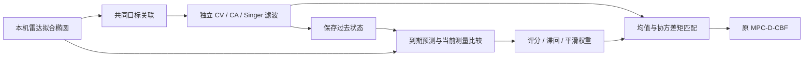

# 因果预测评分与固定种子对照（实验阶段）

新增 `prediction_mode=adaptive`。默认仍为 CV，原引导不变。它是独立 CV/CA/Singer 专家的经验评分与平滑选择候选，不是 IMM，也不提供模型后验概率或新的安全保证。完整结果见 [配对验证](stages/reliability_seeded_validation.json) 与 [阶段报告](stages/reliability_seeded_research_notes_2026-11-01.md)。

## 在线链路



本轮自适应针对外部障碍物；同伴机器人的包络预测仍为既有里程计与本机回波方案。

三个滤波器共享一套目标 ID 和相同拟合测量，避免因各自匹配不同对象而伪造模型优劣。关联使用上一拍权重下的预测中心，带原距离门限和 Hungarian 分配。各专家独立更新，没有滤波状态相互混合。

只向选择器输入拟合椭圆与扫描时间戳，没有真值、场景阶段或预设速度。保存过去各专家的状态／协方差，待 1 s 后的新测量到来，用该过去状态传播到实际测量时刻，再与当前测量中心比较；评分在本帧滤波更新之前计算。没有拿本帧更新后的状态给自己评分。

## 评分与选择

每个专家的误差与平滑评分为：

```
error_m = min(||predicted_center_m - measured_center||², 0.25²)
score_m = (1-alpha)*score_m + alpha*error_m
alpha = 1-exp(-elapsed_score_time/0.5)
```

只使用最近一个已到期、年龄不超过 `1 + max(0.15,2*dt)` 秒的过去预测；过晚的数据不强行配对。不重复处理相同时间戳，不将漏检当成一次测量。新目标以 CV 权重 1 冷启动，至少积累 3 次评分才允许选择。

- 非 CV 候选需比当前专家评分低至少 20%，且绝对改善超过 `0.015² m²`。
- 若 CV 与最佳评分之差不超过该误差地板，优先 CV，避免在不可区分的噪声中维持复杂模型。
- 候选连续满足 3 帧且距上次选择至少 0.6 s 才切换目标专家。
- 权重按 `w_next=(1-beta)*w+beta*one_hot(selected)` 过渡，`beta=1-exp(-elapsed/0.3)`。

这些是固定的工程门限；“20%”不是统计置信水平，重叠预测误差也不是独立样本。平滑的是专家权重，不保证控制输入变化率；没有新增硬控制增量约束。

## 预测与不确定性

每个预测节点的模型权重在本次窗口内固定，位置矩匹配为：

```
mean = sum(w_m * mean_m)
P = sum(w_m * (P_m + (mean_m-mean)*(mean_m-mean)^T))
```

保留模型中心分歧项，不能只平均专家协方差。最新测量的几何包络围绕融合中心重新保守包络；沿用原几何噪声膨胀和专家反应裕量的加权值。单一专家权重为 1 时，中心、预测轴和位置协方差退化回对应 CV/CA/Singer 包络，已有数值检查。

矩匹配描述的是工程混合模型，不等于校准后的真实误差分布；原 `0.95` 乘数也不是 95% 安全概率。该包络不保证覆盖每个低权重假设、完整未知障碍物或所有遮挡情形。NLP 的原速度／角速度边界、动力学、DCBF 与兜底保留；没有证明新的鲁棒安全或递归可行性。

## 参数与版本

默认参数为 `reliability_horizon=1, score_tau=0.5, weight_tau=0.3, score_floor=0.015, switch_ratio=0.8, switch_hold=0.6`；可由 `/cbf/dynamic/reliability` 字典显式覆盖，实际值写入元数据。本轮固定默认值，没有在验证种子结果上调参。

固定种子通过 `gazebo_seed` → `extra_gazebo_args=--seed ...` 传入 Gazebo；测试器读取真实 Gazebo 进程参数和运行元数据核验。空参数保留旧启动行为。固定 Gazebo 种子不会冻结 ROS 回调、创建时刻或墙钟预算 IPOPT，因此不保证逐位复现。

算法与测试协议在提交 `1e03cfc` 冻结。矩阵为种子 41/73 × 加速／减速／停走 × CV/CA/adaptive，共 18 次主试验；另预定一次 CV 相同种子重复，单独报告，不当作第三个独立种子。方法顺序轮换。失败不为求好结果而重试，也没有移动障碍物或延长验证时限。

## 使用与验证

```bash
source /opt/ros/noetic/setup.bash
source devel/setup.bash
rospack find tb3_distributed_control  # 必须指向研究副本
roslaunch tb3_distributed_control single_turtlebot3_cbf_dynamic.launch \
  scenario:=stop_go_crossing prediction_mode:=adaptive gazebo_seed:=41 total_time:=40

python3 -m unittest discover -s src/tb3_distributed_control/scripts/tests -p 'test_cbf*.py' -v
python3 src/tb3_distributed_control/scripts/tests/run_cbf_reliability_matrix.py \
  --seeds 41 73 --output /path/to/new_seeded_comparison
python3 src/tb3_distributed_control/scripts/tests/analyze_cbf_reliability.py /path/to/new_seeded_comparison
python3 src/tb3_distributed_control/scripts/tests/audit_cbf_reliability.py /path/to/adaptive_result
```

仅在隔离仿真中验证；尚未验证新候选的五机与实物。既有 CV/CA/Singer/frozen 及原引导保留。当前共 79 项检查通过；19 次指标审计重建 6410 个采用规划样本，6 次候选的 1912 条在线预测可由原始拟合测量精确重建。审计不读取真值，也检查了评分时标和协方差。

名义误差、朝向符号和上一采用规划误差仍为 schema 2。图表、源文件 SHA、协议、失败、同种子重复与原始数据独立保存；大体积数据不进 Git。该阶段已实现在线判断，但闭环没有形成整体优势，不推荐把默认改为 adaptive。
